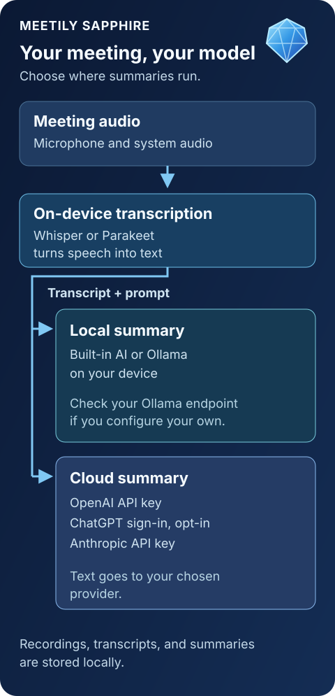

# Meetily Sapphire


Meetily Sapphire is a free, open-source desktop meeting assistant. It records microphone and system audio, transcribes the conversation on your computer, and turns the transcript into meeting notes. You choose where the summary runs.

In a sample planning meeting, Maya says, “Let’s ship the revised onboarding flow. I’ll have the rollout checklist ready by Friday.” A summary can capture both the decision and the commitment.

> **Decision** Ship the revised onboarding flow.
>
> **Action** Maya will prepare the rollout checklist by Friday.

## Build from source

Build this fork from source. Follow the [build guide](docs/BUILDING.md) for platform prerequisites and the required `llama-helper` sidecar setup. Installing frontend dependencies does not stage the sidecar.

Once the prerequisites and sidecar are ready, from `frontend/` run:

```sh
pnpm install --frozen-lockfile
pnpm run tauri:dev
```

Use pnpm 9.15.9. For a production build, follow the release sidecar instructions in the build guide, then run `pnpm run tauri:build` from `frontend/`. Platform details are in the [Linux](docs/building_in_linux.md) and [GPU acceleration](docs/GPU_ACCELERATION.md) guides.

## Choose where summaries run



Whisper and Parakeet transcribe audio on your device. Recordings, transcripts, and completed summaries are stored locally. For offline summaries, select a built-in model or a locally running Ollama model after downloading its weights.

For hosted summaries, open **Settings → Summary Model Configuration**. The selected provider receives the transcript text and summary instructions.

- **OpenAI API key** uses your OpenAI API account. Pick a discovered model or enter its exact ID.
- **ChatGPT plan** uses an eligible Plus or Pro account. Choose **Continue with ChatGPT** to see the models available to your account. Automatic summaries have a separate opt-in you can turn off. **Manage usage** opens your ChatGPT usage controls. Switching to API-key billing is a manual choice. [OpenAI’s plan usage guide](https://developers.openai.com/siwc/token-sharing-open-source)
- **Anthropic API key** uses your Anthropic account. Pick a Claude model from your account catalog or enter its exact ID.

Groq, OpenRouter, and custom OpenAI-compatible servers are also available. An Ollama or custom server can run on another machine, so its configured address determines where the transcript goes. [Audio and storage architecture](docs/architecture.md)

## Contributing

Feature work goes into `Development` before release on `main`. Use synthetic or redacted meeting material in examples and reports. [Contribution guide](CONTRIBUTING.md) · [Fork pull requests](https://github.com/plgonzalezrx8/meetily-sapphire/pulls)

## License and credits

Meetily Sapphire is available under the [MIT License](LICENSE.md). Copyright © 2024 Zackriya Solutions and contributors as applicable. Thank you to the [upstream Meetily project](https://github.com/Zackriya-Solutions/meetily) and its contributors.

The project also draws on [whisper.cpp](https://github.com/ggerganov/whisper.cpp), [Screenpipe](https://github.com/mediar-ai/screenpipe), and [transcribe-rs](https://github.com/cjpais/transcribe-rs). Thanks to NVIDIA for Parakeet and [istupakov](https://huggingface.co/istupakov/parakeet-tdt-0.6b-v3-onnx) for its ONNX conversion.
